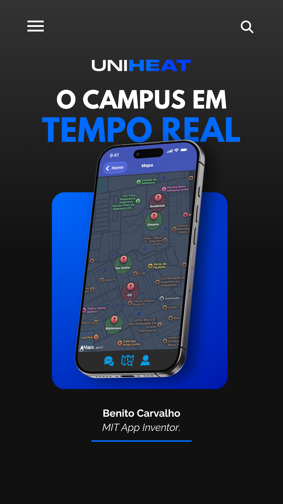
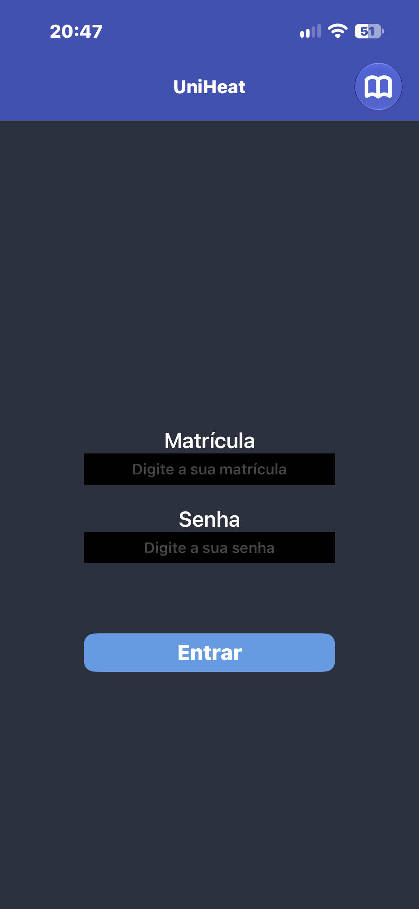
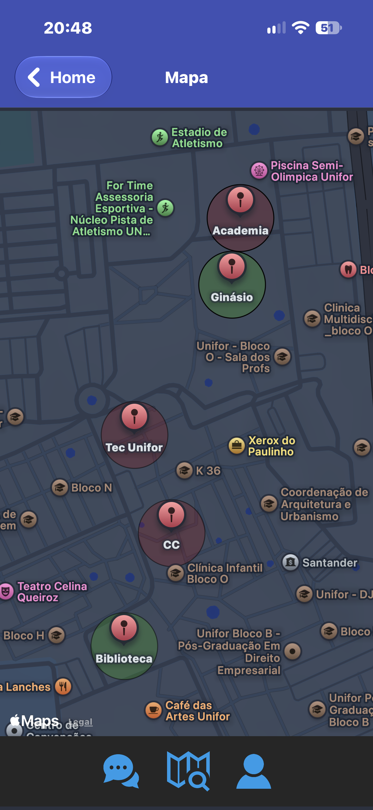
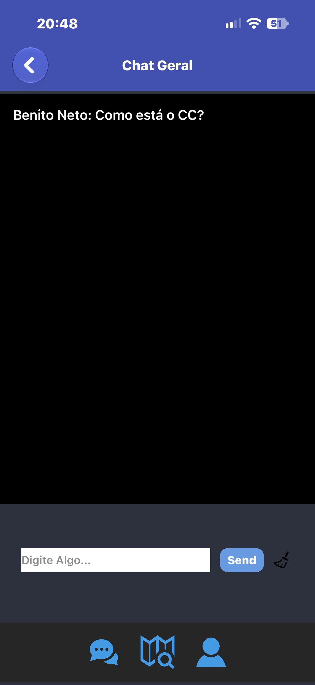
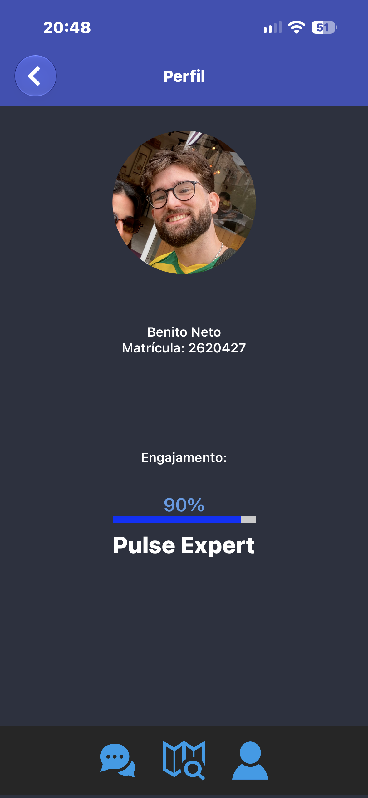

# UniHeat — O campus em tempo real

App mobile que mostra quais áreas da UNIFOR estão tranquilas ou movimentadas, com base no feedback dos alunos.

Projeto da disciplina Experimentação Orientada, no curso de Ciência da Computação da UNIFOR (2026).

## O problema

Alunos perdem tempo procurando um lugar tranquilo para estudar e se deslocando pelo campus sem saber como está cada área. Não existe uma informação centralizada e em tempo real sobre o movimento do campus, nem um espaço simples para os alunos trocarem informações.

## A solução

O UniHeat funciona como um mapa de calor da universidade, alimentado pelos próprios alunos:

- **Mapa de calor:** cinco pontos do campus (Academia, Biblioteca, Centro de Convivência, Ginásio e TecUnifor). O aluno toca em um ponto e marca "Sem movimento" (verde) ou "Movimentado" (vermelho).
- **Chat geral:** mensagens com o nome de quem enviou e histórico salvo.
- **Perfil com gamificação:** cada feedback vale +10% de engajamento, e a inatividade tira pontos. As classes são Novato, Colaborador, Explorador e Pulse Expert.
- **Navegação:** barra inferior entre Chat, Mapa e Perfil.

## Demonstração

https://github.com/user-attachments/assets/157d8bd5-c246-4d26-9aef-040b1cf78a9b

## Telas

| Login | Mapa de calor | Chat geral | Perfil |
| --- | --- | --- | --- |
|  |  |  |  |

## Tecnologias

- [MIT App Inventor](https://appinventor.mit.edu) (programação em blocos)
- TinyDB (armazenamento local de dados)

## Como testar

1. Baixe o arquivo `UniHeat.aia` deste repositório.
2. Acesse o [MIT App Inventor](https://ai2.appinventor.mit.edu) e entre com uma conta Google.
3. Vá em **Projects > Import project (.aia) from my computer** e selecione o arquivo.
4. Use o app MIT AI2 Companion no celular para ver o app funcionando.

## O que eu fiz

Desenvolvi o projeto individualmente: a ideia, o app, a identidade visual (logo e paleta preto e azul elétrico), os testes e a apresentação.

## O que eu aprendi

- Transformar um problema real do dia a dia em uma solução de produto.
- Lógica de programação, eventos e persistência de dados.
- Design de interface e identidade visual aplicados a um app.
- Gamificação como forma de estimular o engajamento.

## Limitações

Este é um protótipo: o login é de demonstração, o chat é local (sem servidor) e os dados de movimento vêm apenas do feedback dos alunos.

## Próximos passos

O UniHeat está sendo reconstruído como aplicação web, em etapas:

- [ ] Versão web com HTML, CSS, JavaScript e mapa real do campus
- [ ] Versão em React e TypeScript
- [ ] Servidor real com Node.js e PostgreSQL: login, mapa e chat compartilhados entre usuários
- [ ] Testes automatizados e testes com alunos da UNIFOR

## Autor

**Benito Carvalho Vaz Neto** — Estudante de Ciência da Computação na UNIFOR
[LinkedIn](https://www.linkedin.com/in/benito-neto/)

---

© 2026 Benito Carvalho Vaz Neto. Todos os direitos reservados. O código, o design e a identidade visual deste projeto não podem ser reutilizados sem autorização.
